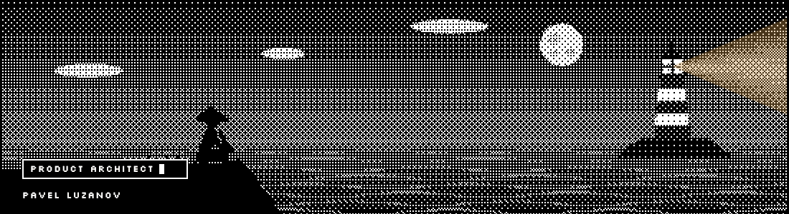

# Pavel Luzanov

Tech lead · Product architect · Front-end engineer Tokyo, Japan · <a href="https://gitpash.github.io">Blog</a> · <a href="https://linkedin.com/in/pavelluz">LinkedIn</a> · <a href="mailto:arklogin@gmail.com">Email</a>

  

I work from business need to shipped feature, combining product thinking, domain expertise, and hands-on front-end engineering. I also provide technical leadership and use AI agents to work effectively beyond my core stack when useful.

## What I work with

<strong>Languages:</strong> TypeScript · JavaScript · Python <strong>Frontend:</strong> React · Astro · Svelte

## Selected work

- **[Personal site & blog](https://github.com/gitpash/gitpash.github.io):** Built with Astro. [Live site](https://gitpash.github.io).
- **[agent-artifact-protocol](https://github.com/gitpash/agent-artifact-protocol):** Git-native conventions that help coding agents orient themselves in a repository.
- **[distractor-lab](https://github.com/gitpash/distractor-lab):** A browser-based contrast-sensitivity trainer using adaptive Gabor patches. [Live demo](https://distractor.pages.dev).

Open to senior, staff, and tech-lead roles in Europe and North America.
